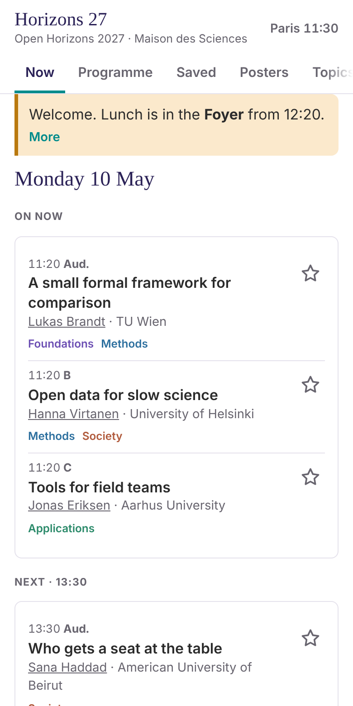
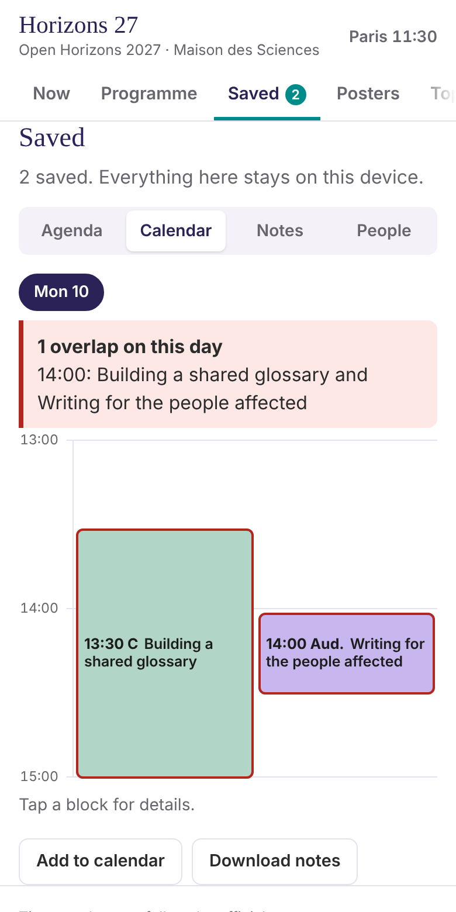
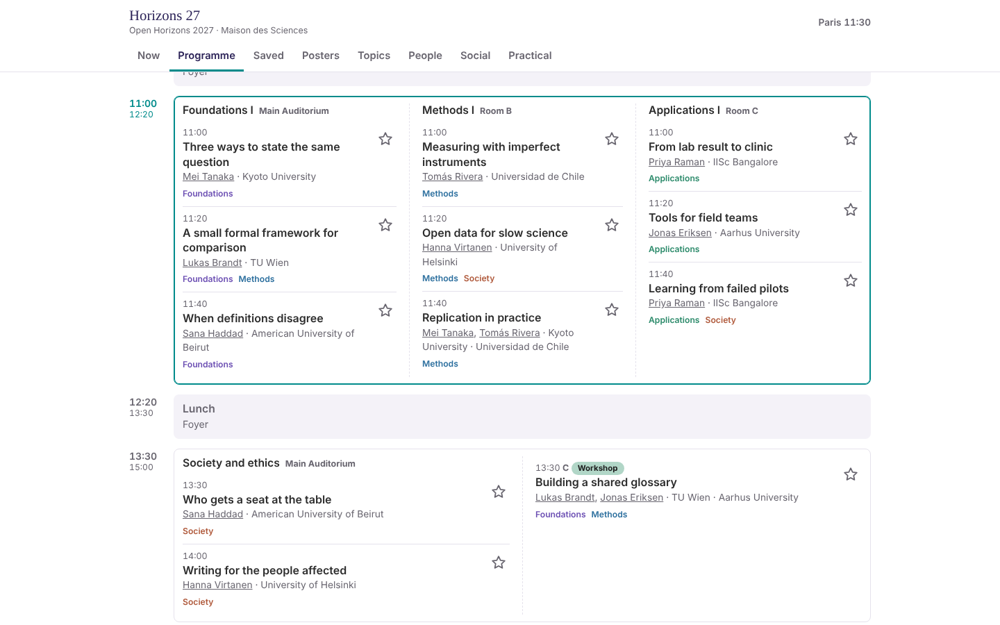

# Conference Atlas

A small web app for a conference programme. People open a link in any browser, on a phone, a tablet or a laptop, star the talks they want to see, write notes, and get a warning when two of their talks overlap. Nothing needs to be installed. Those who like it can add it to their home screen or desktop and use it like an app. What they save stays on their own device. There is no account and no cookie banner, and the app keeps working when the Wi-Fi gives up.

It has been tested at a conference with more than 300 participants. Everything about your conference comes from one file, `conference.js`.

  
  

  

Try the demo: [nefinia.github.io/conference-atlas](https://nefinia.github.io/conference-atlas/?sim=2027-05-10T11:30). It opens an example conference at a busy moment on day one.

## What people see

- **Now** shows the clock in the conference's time zone, what is on and what comes next, and the organisers' announcements.
- **Programme** lists every session by day, with parallel sessions side by side, abstracts, search and theme filters.
- **Saved** holds the stars and notes as an agenda, as a calendar that shows overlaps, and as notes. It exports to a calendar file (.ics) and to Markdown.
- **Posters**, **Topics**, **People**, **Social** and **Practical** cover the rest of the booklet.
- **Board**, **Ask AI** and **Backup** are optional and need the small server in `worker/`.

Each tab is a switch in `conference.js`.

## Start

1. Open `conference.js` in a text editor and replace the demo with your conference.
2. Double-click `index.html` to see it.
3. Upload the whole folder to a website (GitHub Pages is free). The address is your app.

No Python, no Node and no installation are needed for these three steps.

Have a spreadsheet or a PDF programme? `docs/setup.md` shows how to fill `conference.js` from it. `docs/organiser-kit.md` has the email paragraph, the slide and the QR code.

## What is in the folder

| File | What it does |
|---|---|
| `index.html` | The whole app: markup, style and code in one file. No framework, no build step. |
| `conference.js` | Everything about your conference. |
| `live.json` | Last-minute announcements and programme changes, when you have no server. |
| `admin.html` | Organiser page. Announcements and changes work without a server. Feedback, moderation and numbers need the server. |
| `sw.js`, `manifest.webmanifest`, icons | Offline use and the home-screen icon. Replace the icons with your own. |
| `tally.js` | Cookieless statistics, used only when the server is on. |
| `worker/` | The optional server, one Cloudflare Worker for any number of conferences. |
| `tools/` | `validate`, `setup`, `csv-to-conference`, `make-qr`. |
| `docs/` | Guides and the field reference. |
| `tests/` | Checks that run in a real browser. See `tests/README.md`. |

## Without a server and with one

The app works fully by itself. A server is a small extra and nothing in the programme depends on it.

| | Without a server | With the optional server |
|---|---|---|
| Programme, stars, overlap warnings, calendar, notes, download | yes | yes |
| Works offline after the first visit | yes | yes |
| Announcements and moved or cancelled talks | write them on `admin.html`, download `live.json`, upload it to your website | one button on `admin.html`, no upload |
| Ask AI, Board, encrypted backup | no | yes |
| Private feedback and one-tap rating counts | no | yes |
| Anonymous statistics | no | yes |

`admin.html` is the organiser page. Open it in a browser and press "Start without a server" for the first column. For the second column you set up the server once, see `docs/worker-setup.md`.

The server is one Cloudflare Worker with a small database, in your own Cloudflare account, and it can serve several conferences. Each conference gets its own assistant budget, allowed website, retention date and feedback inbox.

Privacy follows from the design. The server stores no addresses. Counters use daily hashes. Backups are encrypted on the phone with a key only the person holds. Board posts are deleted on the date you set, and anyone can delete their own at any time.

## What the first conference showed

The numbers are in `docs/lessons.md`. Three things shaped the template. Most people arrived through the organisers' email, so the kit starts with that paragraph. The programme on the phone carried almost all the use, so it comes first. The extra features each reached a small group, so they are switches.

## Credit and help

Made by Sofia Gallego / CosmoVentures. [cosmoventures.fr](https://cosmoventures.fr) · [sofiagallego.com](https://sofiagallego.com)

Help with setting it up for your conference is available through cosmoventures.fr.

The app adds a small line at the bottom with these links. You can hide it with `"credit": false` in `conference.js`, and add a line of your own in `conference.creditLine`. A kept credit helps other organisers find the project.

## Licence

MIT. See `LICENSE`.
